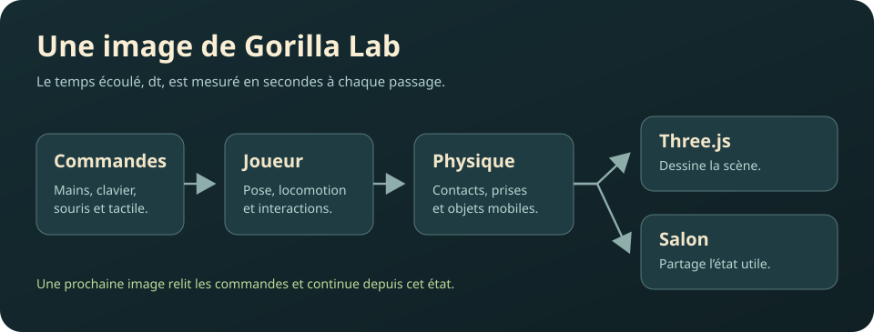
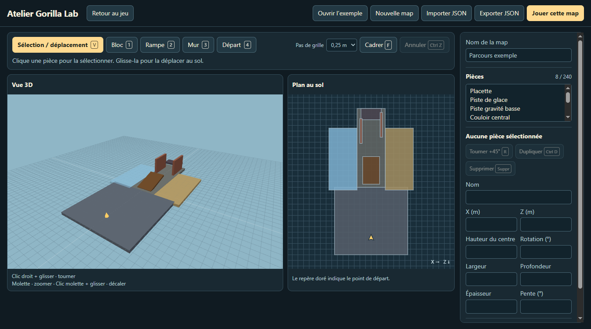

# Reprendre Gorilla Lab

Gorilla Lab est une arène de test pour apprendre à fabriquer un jeu 3D sur le Web. Le premier défi consiste à charger l'arène, modifier une chose et retrouver son effet à l'écran.

| Tu veux… | Ouvre… |
| --- | --- |
| Comprendre comment le jeu tourne | [Architecture et systèmes](architecture.md) |
| Créer une entité, un bouton ou un effet | [Atelier pas à pas](atelier.md) |
| Installer, vérifier, publier et dépanner | [Guide de maintenance](verification.md) |
| Passer directement à l'éditeur | [Atelier de cartes](../../editor.html) ou [atelier de modèles](../../model-editor.html) |
| Voir où sont les zones de test | [Plan de l'arène](../../floor-plan.html) |

## Par quoi commencer

1. Ouvre une partie sur PC et repère le panneau **Spawn**. Fais apparaître une baguette, puis saisis-la.
2. Dans le dépôt, ouvre le fichier [main.js](../main.js) et cherche `spawnObject`. Remonte jusqu'au catalogue qui définit les types d'objets.
3. Ouvre [lab-props.js](../lab-props.js) et trouve la fabrique de la baguette. Change un seul paramètre visible, puis reconstruis le jeu.
4. En jeu, vérifie ta modification sur un nouvel objet. Tu viens de suivre le chemin qui va du code source au rendu.

Dans JavaScript, un **objet** est un ensemble de propriétés. Dans le jeu, une **entité** est quelque chose qui a une identité et un comportement, comme un objet saisi, un bouton ou une caméra. Une entité peut contenir plusieurs objets JavaScript. Un **module** est un fichier qui exporte des fonctions ou des classes destinées aux autres fichiers.

**Le principe à retenir**. La manette fournit une position. La locomotion décide si cette position peut déplacer le joueur. La physique décide si un objet peut bouger. Three.js dessine le résultat. Le réseau transmet certaines décisions aux autres écrans.

## Les demandes et leurs réponses dans le code

| Ce que tu voulais tester | Comment c'est construit | Point de départ |
| --- | --- | --- |
| Plaine, pentes, glace, gravité faible, murs, vallons et parcours | Une carte découpée en zones, un plan d'implantation, des volumes solides et un terrain échantillonné | [lab-layout.js](../lab-layout.js), [arena.js](../arena.js) |
| Déplacement à la Gorilla Tag, rotation de 45°, appuis sur les bords | Balayage des paumes, ancrage, mouvement du joueur opposé à celui de la main, puis élan calculé à partir du déplacement réel | [locomotion.js](../locomotion.js) |
| Monter sur un objet ou utiliser une baguette pour gagner de la portée | Un objet libre offre une surface de contact. Pour certains objets tenus, le point de contact s'étend vers leur extrémité | [main.js](../main.js), [physics.js](../physics.js) |
| Petit retour de manette à chaque appui | Un changement d'état vers un contact au sol déclenche une impulsion courte sur la manette concernée | [ground-haptics.js](../ground-haptics.js) |
| Mains arrondies, trois doigts, bras et torse raccordés | Un maillage de corps continu reçoit la pose des mains et les pressions des boutons. Le torse se penche avec la tête | [hand-skin.js](../hand-skin.js), [body-skin.js](../body-skin.js), [avatar-style.js](../avatar-style.js) |
| Saisie, lancer, rebond et objets détaillés | Une géométrie visible, une masse et une forme de collision distinctes. Les objets tenus passent par le même balayage cinématique | [lab-props.js](../lab-props.js), [physics.js](../physics.js) |
| Tool Gun, laser coloré et boutons pressables | Un rayon détermine la cible. Une action modifie l'objet. Les bornes animent leurs touches et partagent l'action entre le toucher et la visée | [tool-visual.js](../tool-visual.js), [fixtures.js](../fixtures.js), [main.js](../main.js) |
| Pistolet et tir continu | Cadence de 100 ms, traits tricolores rectilignes, recherche d’impact et particules réutilisées | [arcade-blaster.js](../arcade-blaster.js) |
| Gelée et cube du Néant | Le matériau anime le rendu. La collision garde une forme stable | [animated-props.js](../animated-props.js) |
| Panneau VR, contrôles PC et tactiles, éditeurs | Un jeu commun reçoit plusieurs types d'entrée. Les outils de création éditent des données contrôlées et exportables | [main.js](../main.js), [flat-controls.js](../flat-controls.js), [editor.js](../editor.js), [model-editor.js](../model-editor.js) |
| Terrain sculptable, herbe, buissons et textures 512 × 512 | Une grille donne le relief. Le rendu et la collision lisent les mêmes échantillons. Le décor est répété par instanciation et les textures se raccordent | [terrain-edit.js](../terrain-edit.js), [seamless-texture.js](../seamless-texture.js) |
| Ciel, nuit sombre, ombres, shaders et focus réglable | Textures de ciel préparées au chargement, niveaux de qualité et effets séparés. Le casque peut appliquer son propre rendu fovéal | [sky-texture.js](../sky-texture.js), [arena.js](../arena.js), [vr-effects.js](../vr-effects.js) |
| Spectateur PC, caméra saisissable et jeu PC/mobile dans un salon | Le casque publie l'état du monde. Le relais TurboWarp transmet les données et les clients affichent des copies lissées | [cloud-link.js](../cloud-link.js), [cloud-view.js](../cloud-view.js) |

Le dépôt contient aussi des bundles comme `game-lab-rNN.js`. Ce sont des fichiers générés. Modifie les sources lisibles dans `gorilla-lab/`, puis reconstruis le bundle.

## Aperçu de l’atelier

