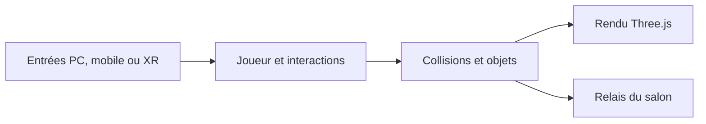
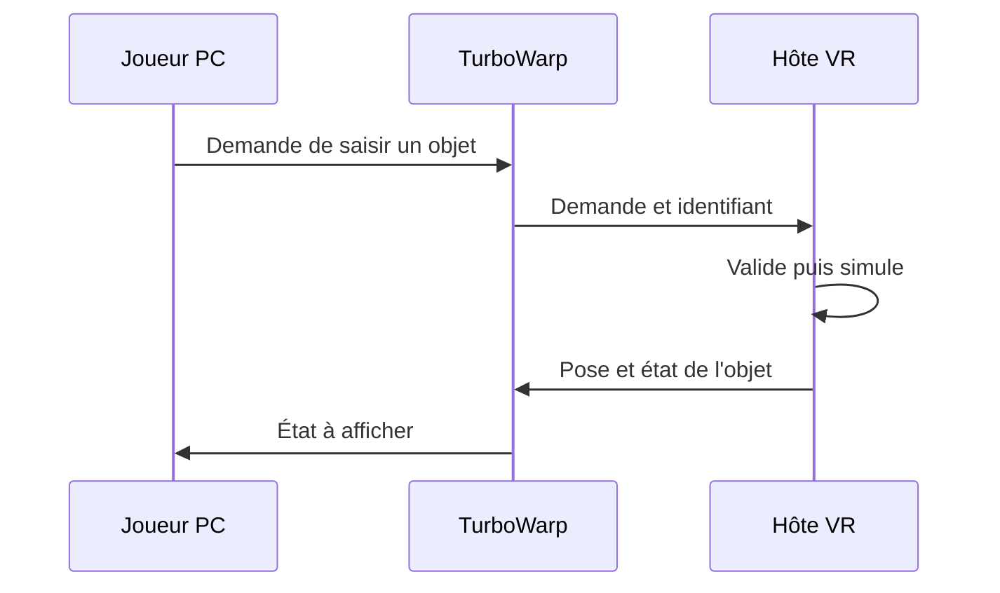

# Architecture et systèmes

[Retour au guide](README.md) · [Atelier](atelier.md) · [Maintenance](verification.md)

## Lire une image du jeu

[main.js](../main.js) installe le moteur de rendu, le décor, la caméra et une boucle avec `renderer.setAnimationLoop`. À chaque image, cette boucle lit les commandes, avance la simulation, prépare certains effets puis dessine la scène. Un navigateur VR laisse le casque fournir les poses de la tête et des manettes. Sur écran plat, la souris, le clavier et les gestes tactiles construisent les commandes du personnage.

`dt` représente le temps écoulé en **secondes**. Une vitesse de 2 m/s pendant 0,01 s donne un déplacement de 0,02 m. Le code limite la durée d'une image côté simulation pour éviter qu'une reprise après une longue pause produise un bond gigantesque. Dans la scène, **Y monte**, et une caméra non tournée regarde vers **−Z**.

| Terme dans le code | Ce qu'il désigne |
| --- | --- |
| `Vector3` | Trois nombres utilisés pour une position, une direction ou une vitesse |
| `Quaternion` | Une rotation que la simulation et le réseau peuvent composer et interpoler |
| `Mesh` | Une géométrie à dessiner avec un matériau, une position et une rotation |
| `Group` | Un parent qui déplace tous ses enfants, comme une borne ou un modèle composé |
| `Collider` | La forme utilisée pour tester des contacts |
| `Raycaster` | Un test de visée depuis une origine et une direction |

Un `Mesh` enfant peut être à 10 cm de son parent. En **coordonnées locales**, sa position est ce décalage. En **coordonnées monde**, on tient aussi compte du parent et de ses propres parents. Pour manier un outil, vise avec une origine et une direction exprimées dans le même espace.

## Locomotion et appuis

La pose réelle de la manette donne une **cible**. La paume simulée poursuit cette cible par un balayage entre sa position précédente et la nouvelle. Si elle rencontre un sol ou un mur, le solveur garde un point d'**ancrage**. Pousser la main vers un mur fait reculer le corps. Pousser la main vers le sol peut faire monter le corps.

On limite la portée du bras. On moyenne les contributions si les deux mains travaillent en même temps. La friction du matériau et la normale déterminent combien l’ancrage glisse. Le solveur projette le déplacement et la gravité sur le plan de contact, balaie le trajet, puis vérifie l’appui à l’arrivée. Sur un mur, ce glissement descend le long de la paroi. Une poussée assez vive produit une impulsion qui sort du contact. Le glissement seul n’ajoute pas d’impulsion. Après correction des collisions du joueur, [locomotion.js](../locomotion.js) mesure le déplacement réellement obtenu pour estimer l'élan. Sinon, pousser vers une direction que le corps ne peut pas emprunter donnerait quand même une vitesse de départ.

Lis dans cet ordre :

1. `trackHands` dans [main.js](../main.js) pour les contrôleurs, les prises et la cible.
2. `palmContact` dans [physics.js](../physics.js) pour le balayage de la forme de la paume.
3. `move` et `finish` dans [locomotion.js](../locomotion.js) pour le contact, le déplacement et l'élan.
4. `updateGroundHaptics` dans [ground-haptics.js](../ground-haptics.js) pour l'impulsion à l'arrivée sur un appui. Un état par main et un délai anti-rebond empêchent une vibration à chaque image.

Un appui au sol est ici un contact dont la normale pointe suffisamment vers le haut. La **normale** est une flèche perpendiculaire à la surface. Elle permet aussi de différencier une pente d'un mur.

Le [Player.cs d’Another Axiom](https://github.com/Another-Axiom/GorillaLocomotion/blob/main/Player.cs) et son [composant de surface](https://github.com/Another-Axiom/GorillaLocomotion/blob/main/Surface.cs) décrivent la portée des mains, les balayages successifs sur le plan de contact, le glissement par surface et l’élan plafonné. Gorilla Lab adapte ces principes à son balayage convexe de paume et à ses réglages de gravité, d’adhérence et de glissement.

### Pourquoi utiliser des formes simples

Le mode **High** est actif par défaut. La paume a un volume de huit triangles calé dans le repère du maillage de la main, avec la même rotation que celui-ci. Le grand rectangle utilise un parallélépipède de 1,42 × 0,75 × 0,88 m avec la rotation de l’objet. La grande sphère utilise son rayon de 0,60 m pour garder un roulement régulier. Les faces visibles de la sphère s’inscrivent à l’intérieur de ce rayon.

La géométrie visible d'un téléphone peut avoir des coins arrondis et un écran détaillé. Sa forme de collision peut être un petit volume convexe. Une roue sphérique ou cylindrique doit avoir une forme de collision adaptée à la façon dont on veut qu'elle roule. Le solveur réutilise les mêmes règles pour la plupart des objets.

Dans [physics.js](../physics.js), le test de proximité élimine les paires distantes avant les calculs détaillés. Les sous-étapes divisent la durée d'une image pour réduire le risque de traverser un mur mince. Le solveur corrige les chevauchements et applique les effets de rebond, rotation et friction. `moveKinematic` déplace un objet tenu vers une pose demandée en testant le trajet. La vitesse du geste reste disponible au lâcher.

## Rendu, textures et enveloppe de performance

Une **texture** est une image projetée sur le maillage par des coordonnées `UV`. [texture-geometry.js](../texture-geometry.js) règle leur répétition à l'échelle des dimensions du bloc. En étirant simplement les mêmes UV sur un mur deux fois plus long, on étirerait aussi les détails. [seamless-texture.js](../seamless-texture.js) génère des motifs qui se répètent sans bord apparent.

[arena.js](../arena.js) assemble éclairage, ombres, matériaux, ciel et niveaux de qualité. La carte de lumière est une estimation d'éclairage préparée à partir du décor. Une **ombre dynamique** est recalculée depuis la lumière sur un budget de fréquence et de résolution. Les sources lumineuses les plus proches utilisent un nombre borné de lumières ponctuelles.

[vr-effects.js](../vr-effects.js) compose les deux yeux dans le chemin Post FX. La version précédente sous-échantillonnait les images intermédiaires. Le chemin actuel conserve les dimensions de la vue de chaque œil et réserve le halo aux zones lumineuses. La **fovéation** réduit le détail sur les bords de la vision. Quand la couche XR expose la fovéation matérielle, le jeu l'utilise. Le repli logiciel peut changer l'apparence des textures sans garantir le même gain de FPS.

Les effets de [animated-props.js](../animated-props.js) illustrent deux techniques :

- La gelée modifie la position des sommets visibles à partir d'une horloge partagée.
- Le cube superpose des couches d'étoiles dont le décalage varie avec l'angle de vue. Ce décalage apparent est la **parallaxe**.

La R26 sépare ces effets visuels de la forme utilisée pour les collisions. Une boule qui ondule à l'écran reste donc prévisible au lancer.

## Cartes, terrain et modèles

`parseMap` dans [map-format.js](../map-format.js) vérifie le format et borne les valeurs avant de les appliquer. [editor.js](../editor.js) présente un plan au sol, une vue 3D, un inspecteur et un historique d'annulation. Le brouillon du navigateur est séparé du fichier JSON que tu exportes. Les imports asynchrones appliquent la demande la plus récente. Les surfaces qui partagent une même image réutilisent sa texture pendant qu’elles en ont besoin. [custom-maps.js](../custom-maps.js) charge la carte en jeu et génère les maillages et les colliders.

Un terrain est une **grille de hauteurs**. Les mêmes échantillons servent à dessiner les triangles et à trouver le sol sous le joueur. Le bruit, la graine et le sculpt sont séparés. La graine rend le relief et le placement du décor reproductibles. Pour l'herbe, l'**instanciation** affiche plusieurs copies d'une même géométrie avec leurs propres transformations. C'est utile pour éviter des centaines d'objets de scène uniques.

[model-pack.js](../model-pack.js) valide la collection de modèles. L'atelier permet d'assembler des primitives et de les publier pour le menu Spawn. Le remplacement d'avatar porte sur la tête du joueur local et son miroir. Les bras et les mains conservent leur animation de suivi.

## Salon et état partagé

**L'autorité** est la machine qui décide de l'état d'un objet. Dans ce jeu, c'est l’appareil qui héberge le salon. Le PC transmet une demande de saisie, de création ou d'action sur l'objet. L'hôte décide et diffuse l'état. Les autres clients dessinent des répliques et lissent leurs déplacements entre deux paquets.

[cloud-link.js](../cloud-link.js) s'occupe du transport, du format des messages et des identifiants. [cloud-view.js](../cloud-view.js) s'occupe de la caméra, des répliques et de l'affichage de l'état du salon. Le transport utilise des mises à jour groupées et périodiques. Un code de salon sert à retrouver une session. Il ne fait pas office de compte ou de mot de passe. Pour partager une carte et des objets personnalisés, charge la même carte et la même collection sur les appareils du salon.

### Cadence et état partagé

Dans **En ligne**, chaque appareil peut héberger ou rejoindre le salon, au clavier, au tactile ou en VR. Trois arènes publiques ont des noms fixes. Un salon privé se rejoint avec son code ou son lien, qui fait office d’invitation. Le spectateur envoie sa caméra à 5 Hz. Les joueurs visent 10 Hz pour la tête, les mains, les doigts et les armes. Les tirs et les demandes d’interaction utilisent le même paquet avec un numéro de séquence pour récupérer un paquet sauté et ignorer les doublons. Les petits objets rapides (rayon de collision jusqu’à 45 cm, translation ou bord en rotation à partir de 2,5 m/s) utilisent aussi le paquet intermédiaire, jusqu’à 10 Hz. Les autres changements d’objet passent à 5 Hz. La pose d’arrêt est répétée et les états complets périodiques resynchronisent le monde après une perte de paquet. L’hôte applique la physique des tirs et partage aussi l’ambiance, les noix de coco et le score de la cible.

[Turbowarp regroupe les mises à jour et peut en sauter](https://docs.turbowarp.org/cloud-variables#updates-are-buffered). Dépasser 10 envois par seconde ne réduit pas ce délai. L’extrapolation de la position est bornée à 120 ms, ou à 100 ms pour les objets reçus à cadence rapide. Au repos, les répliques convergent vers la position et la rotation publiées par l’hôte. Les effets de son propre tir restent immédiats. Le délai réseau réel varie avec le relais, le trajet réseau et les images du navigateur. Le rapport exporté contient le nombre de paquets et de caractères envoyés et reçus, ainsi que la taille de la file WebSocket au dernier relevé.

Les appareils du salon chargent la même carte. La R32 conserve le format réseau de la R31. Pour héberger sur PC ou mobile et utiliser les salons publics, recharge la R33. Les invités peuvent créer, saisir, modifier, vider ou réinitialiser les objets via l’hôte. Les éditions de carte se partagent par export ou par URL. Les options de confort et de qualité restent locales.

## Où intervenir dans la R34

| Pour modifier… | Fichier |
| --- | --- |
| Les valeurs par défaut, les préréglages ou les noms de modes | [game-settings.js](../game-settings.js) |
| Les gestes tactiles et la distinction entre appui bref et touche maintenue | [flat-controls.js](../flat-controls.js) |
| La résolution du canvas sur mobile et PC | [screen-render.js](../screen-render.js) |
| Le masque de champ visible par œil, avec ou sans Post FX | [vr-fov.js](../vr-fov.js), [vr-effects.js](../vr-effects.js) |
| Les commandes de tir, la visée et les collisions avec le monde | [blaster-system.js](../blaster-system.js) |
| La cadence, le mouvement, les traînées et les particules | [arcade-blaster.js](../arcade-blaster.js) |
| L’ordre des systèmes et le lien avec la scène | [main.js](../main.js) |

Un appui bref, comme **X**, est mémorisé jusqu’à l’image qui le traite. Un mouvement ou un tir maintenu, comme **Z** ou **J**, dépend de l’état courant de la touche. Ce découpage évite de perdre les appuis courts à faible fréquence d’images.

## R35 · Pose, debug, audio et éditeur

| Fichier | Fonctions et données échangées |
| --- | --- |
| [xr-palm.js](../xr-palm.js) | `placeTrackedPalm` transforme la pose `gripSpace` fournie par WebXR en coordonnées de l’arène. Il applique la rotation du joueur puis retire le centre local fourni par `hand-skin.js` pour placer l’origine du maillage. |
| [locomotion.js](../locomotion.js) | `move` limite la portée, balaye la paume via `palmContact` de `physics.js` et produit le déplacement demandé. `finish` lit le déplacement réellement effectué par `main.js`, puis met à jour l’historique d’impulsion. |
| [main.js](../main.js) et [body-skin.js](../body-skin.js) | `character` conserve la pose du casque et résout les trois sphères du corps. `updateTorso` déduit le tangage et le roulis de la tête et de la portée des mains. `poseBody` convertit les poignets dans le repère du torse pour le maillage articulé de `body-skin.js`. |
| [debug-view.js](../debug-view.js) | `update` lit les géométries du solveur, les normales et les poses après déplacement. Le rendu regroupe les traits dans une géométrie. Les vecteurs représentent la direction de la gravité, la vitesse du joueur, le déplacement réalisé et les normales de contact. |
| [step-sound.js](../step-sound.js) | `update` détecte chaque nouvel appui au sol en VR et cadence les pas sur la distance parcourue en PC/mobile. `play` synthétise un bruit court via Web Audio. Le volume est conservé dans le navigateur. |
| [editor.js](../editor.js) et [custom-maps.js](../custom-maps.js) | L’éditeur appelle `buildArena` et partage les objets de départ avec le jeu via `arena-objects.js`. `arenaMap` de `map-format.js` convertit les blocs de l’arène en pièces éditables. Le champ JSON `arenaBase` conserve le relief intégré, les bornes et les objets de départ au chargement. Les cartes v1 existantes sans ce champ gardent leur comportement. |

La pose de prise vient de WebXR. Le centre de la paume au repos utilise le même repère que son collisionneur. Après collision, le repère cyan reste sur la prise suivie et le volume vert montre la pose résolue. La séparation entre les deux permet de voir l’effet de la portée et des appuis. Un objet tenu qui sert d’appui ajoute un second volume au point de contact de l’objet.

Le ralenti applique un facteur au pas simulé. La lecture du casque, les événements audio et la fenêtre d’échantillonnage des manettes restent à cadence réelle. L’entrée dans un salon rétablit ×1 pour que les clients gardent la même cadence de jeu.
