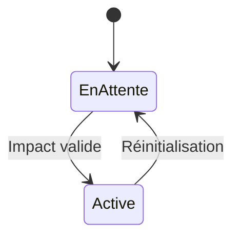
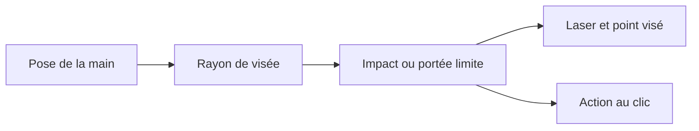

# Atelier pas à pas

[Retour au guide](README.md) · [Architecture](architecture.md) · [Maintenance](verification.md)

Les exemples sont des exercices à appliquer sur ta propre branche. Fais un commit quand chacun fonctionne. Tu pourras revenir à cette étape si la suivante casse.

## 1. Créer une première entité sans écrire de code

1. Ouvre l'**atelier de modèles**. Ajoute un cube, puis un cylindre plus petit et légèrement décalé.
2. Change leurs tailles, rotations et surfaces. Vérifie la forme de côté avant de l'ajouter au jeu.
3. Coche **Saisissable** et **Collisions**. Laisse **Figé au départ** décoché pour le premier essai.
4. Publie le modèle vers le jeu, recharge et cherche-le dans la catégorie atelier du menu **Spawn**.
5. Saisis, tourne, relâche et observe le point de contact au sol. Active **Appui pendant la prise** si l'objet doit servir de bâton.

Exporte aussi la collection en JSON. Ce fichier te permet de transférer l'objet vers un autre navigateur. Les clients d'un salon qui veulent les mêmes objets personnalisés doivent charger la même collection.

## 2. Ajouter une balise par le code

Crée `gorilla-lab/training-props.js`. La balise a deux formes. La géométrie visible est un octaèdre. Une boîte simple assure la collision.

```js
import * as T from 'three';

export function makeTrainingProps() {
  return [{
    id: 'balise',
    name: 'Balise turquoise',
    geo: new T.OctahedronGeometry(.22),
    collisionGeo: new T.BoxGeometry(.25, .31, .25),
    material: new T.MeshStandardMaterial({
      color: '#48d8c6',
      roughness: .40,
    }),
    mass: .9,
    properties: { grabbable: true, collidable: true, frozen: false },
  }];
}
```

Dans [main.js](../main.js), importe `makeTrainingProps` en haut du fichier. Repère les appels `registerProps` et ajoute les lignes suivantes **après les objets animés et avant les modèles d'atelier**. Les types d'origine conservent ainsi leurs indices.

```js
const trainingTypes = [];
registerProps(makeTrainingProps(), trainingTypes);
```

Ajoute `...trainingTypes` à `spawnTypes`. Dans la construction de `spawnGroups`, ajoute un groupe `['Balises', trainingTypes]` au tableau des groupes. Les entrées du panneau appellent déjà `requestSpawn`. Le même chemin choisit un emplacement jouable, crée l'entité et la déclare au système d'objets. Pour tester en salon, assure-toi que tous les appareils chargent le même build et la même collection. Les indices sont utilisés par le protocole. Une modification du catalogue implique de vérifier les limites dans [cloud-link.js](../cloud-link.js).

Vérifie d'abord l'apparition, puis la saisie, puis le rebond. À chacune de ces étapes, ne modifie qu'une chose à la fois. Si tu changes la masse de .9 à 2 avec la même forme, observe le résultat dans une collision entre deux objets plutôt qu'en chute libre. La gravité donne la même accélération à ces deux masses.

### Transformer la balise en vraie entité de jeu

Une première idée est une **balise de contrôle**. Elle a un état `active` et une action `setActive`. Quand un projectile touche la balise, l'action change sa couleur et ajoute un point, une fois par activation. Quand le joueur revient au départ, remets la balise en attente.



Dans cette expérience, la collision détecte l'impact, la logique décide du point et le matériau affiche le résultat. Tu peux tester l'action avec un faux impact dans une page de test avant de brancher le projectile. Pour un score multijoueur, garde la décision chez l'hôte et prévois explicitement une donnée réseau pour le score.

## 3. Ajouter un bouton physique

[fixtures.js](../fixtures.js) contient `station([x, z], name, commands)`, un constructeur interne à `addLabFixtures`. Une commande est un couple `[libellé, action]`. Pour apprendre sans changer la carte, réutilise une borne existante. Dans la station **GROS OBJETS**, remplace provisoirement une touche par un bouton de retour au départ :

```js
['Retour|départ', actions.resetPlayer]
```

Le caractère `|` coupe le texte sur deux lignes. La touche est enregistrée dans la liste des cibles. `key.userData.action` applique l'action, redessine l'étiquette et enfonce brièvement le maillage. Le délai de 250 ms protège contre une double activation rapide. Sur PC et à distance, le rayon vise ce maillage. Le chemin tactile de la manette transforme la position de la main en coordonnées locales de la touche et vérifie le volume sur lequel on peut appuyer.

Pour une nouvelle borne, applique le même constructeur à une position libre repérée sur le [plan de l'arène](../../floor-plan.html). Réutilise un rappel passé dans `actions` plutôt que de faire importer tout le jeu par `fixtures.js`. Les fonctions passées depuis `main.js` permettent à la borne de demander une action sans gérer la physique ni les entrées elle-même.

## 4. Créer un pointeur laser

Dans [tool-visual.js](../tool-visual.js), le laser reçoit un point de départ et un point d'arrivée. Il mesure la différence, positionne le cylindre au milieu, met sa longueur à jour et tourne son axe Y vers la cible. La pointe matérialise l'endroit précis qui sera activé.



Pour un nouveau pointeur, commence par recopier le calcul de pose dans un petit module. Donne des paramètres clairs à sa fonction de mise à jour. Le rayon sert à **chercher** un impact. Le cylindre sert à **montrer** la visée. Dans un éditeur, il est souvent utile de colorer la pointe en vert quand le placement est permis et en rouge quand la zone est déjà occupée.

## 5. Modifier le pistolet de tir

Le **Pistolet de tir** est un accessoire du jeu. Active-le dans **Objets → Pistolet de tir**. Sur PC, **X** permet aussi de le basculer. Maintiens la gâchette droite en VR, le bouton gauche sur la scène ou **J** sur PC, ou **Tirer** sur mobile.

La cadence est un tir toutes les 100 ms, soit jusqu'à dix par seconde pendant l'appui. Le trait part droit et combine jaune, rouge et gris. De petites particules ponctuent le tir et l'impact. Le jeu peut pousser des objets libres sur la machine qui simule le monde. Le pistolet n'a ni munitions à gérer ni dégâts aux personnages. Les effets de tir sont locaux.

Dans [arcade-blaster.js](../arcade-blaster.js), `createArcadeBlaster(scene, { impact })` fabrique l'effet. L'intégration appelle `update({ dt, aim, firing })`. `aim` contient une position, une rotation et une direction. La fonction `impact(start, direction, length)` renvoie la distance à un impact, ou `null` quand le segment reste libre.

**Exercice**. Change la couleur du trait, puis teste le tir en visant un mur mince et un objet proche. Pour ajouter un mode rafale, garde un compteur de tirs dans ce mode et laisse les projectiles et les impacts au module. Garde aussi le nombre d'effets borné. Un **pool** réserve des emplacements et recycle ceux dont l'effet est terminé.

Pour une nouvelle arme, garde la traduction des entrées, la visée et les réactions du monde dans [blaster-system.js](../blaster-system.js). Modifie les paramètres des projectiles et les effets dans [arcade-blaster.js](../arcade-blaster.js). Les valeurs initiales du menu vivent dans [game-settings.js](../game-settings.js).
